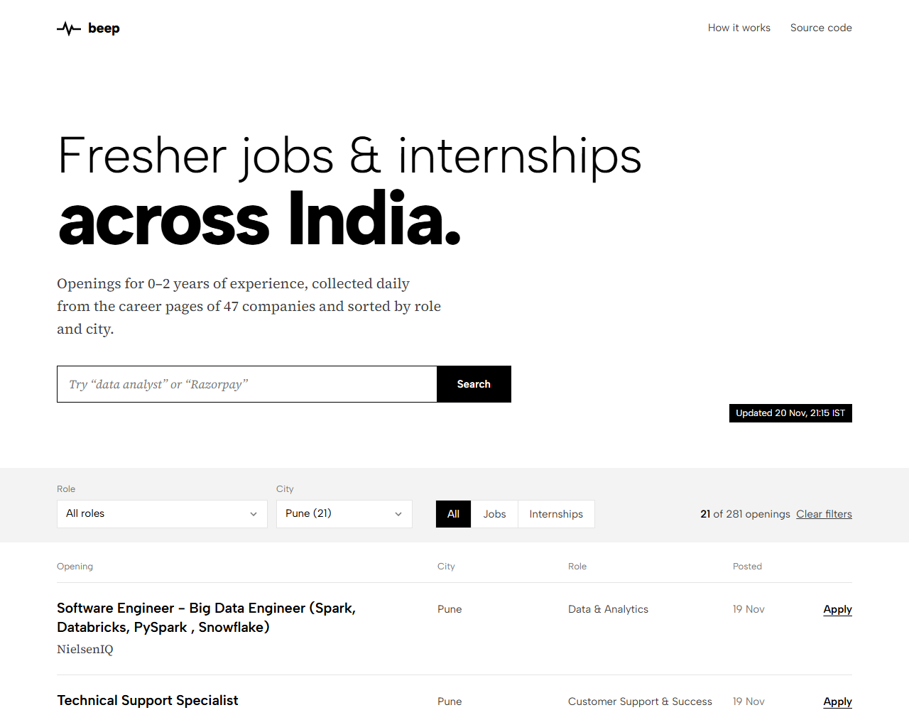
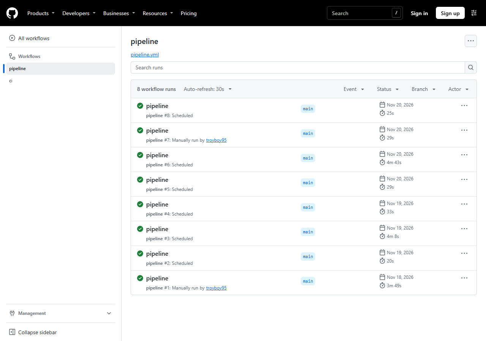

# Beep Tracker: findings and proof

20 Nov 2026 · [Live site](https://beep-tracker.vercel.app)

Three findings shaped this build. Each section below gives the evidence: database queries, LLM ledger records, evaluation files and screenshots of the live system.

## At a glance

All three findings came from measured data, and each fix was checked against the same data afterwards.

| # | Finding | Where it was found | Key evidence | Effect of the fix |
| --- | --- | --- | --- | --- |
| 1 | The LLM filed jobs in listed cities under "Other (India)" | 50-post accuracy check, then the full dataset | LLM ledger: raw outputs vs each post's location; 35 posts changed by the city rule | City accuracy 92% → 100% on the sample; "Other (India)" tags 44 → 19 |
| 2 | The free-tier LLM fails often | First full pipeline run, 18 Nov 2026 | 29 of 66 calls failed with 503 errors, 28 of them in one run; no post lost | Durable queue: 45 untagged posts → 0 on the next run; 11 calls succeeded on retry |
| 3 | "Fresher" can't be judged from job titles | Source probe of 69 boards, then the accuracy check | 46 fresher titles among 2,387 India posts; 5 false positives in the sample | Description-based 0–2 yr rule and stricter titles: precision 84% → 96% |

## Finding 1: listed cities filed as "Other (India)"

The LLM often tagged jobs in Pune, Coimbatore, Vadodara and other listed cities as "Other (India)", which hid them from anyone filtering by city.

**Where it was found.** In the 50-post accuracy check, 3 of the 4 city errors were this pattern (Pune twice, Mysuru once). Checking the whole dataset confirmed it: 25 of 44 "Other (India)" tags named a listed city, mostly SmartRecruiters locations formatted as "City | State code | India".

**Proof: the LLM's own output.** Every LLM call is stored verbatim in the `llm_calls` ledger. For each post below, the LLM's city is read from that raw response and set beside the post's location field.

| Post | Source | Location field | LLM said (ledger call) | Final city |
| --- | --- | --- | --- | --- |
| 140 Security and Automation Engineer | Lever | Pune, Maharashtra \| India | Other (India) (#23) | Pune |
| 253 Applicant - Mortgage | SmartRecruiters | Kochi \| KL \| India | Other (India) (#33) | Kochi |
| 260 R&D Engineer (C++) | SmartRecruiters | Pune \| MH \| India | Other (India) (#34) | Pune |
| 266 Order Management Specialist | SmartRecruiters | Pune \| MH \| India | Other (India) (#34) | Pune |
| 356 Test Automation for Mobile App | SmartRecruiters | Coimbatore \| India | Other (India) (#44) | Coimbatore |
| 101 Analyst | Greenhouse | Lucknow | Other (India) (#18) | Lucknow |

**The fix.** A deterministic rule now sets the city when every place in the location field maps to one listed city, and the LLM decides everything else. The ledger keeps the LLM's original answer, and a `city_source` column records whether the rule or the LLM set each city.

**Measured effect.** Across the dataset (`eval/proofs/evidence.json`):

| Change made by the rule | Posts |
| --- | --- |
| Other (India) → Pune | 14 |
| Other (India) → Coimbatore | 6 |
| Other (India) → Vadodara | 4 |
| Other (India) → Kochi | 2 |
| Other (India) → Mysuru, Lucknow, Jaipur | 3 |
| Multiple cities or Remote → one city | 6 |
| **Total** | **35** |

- 28 of the 35 were SmartRecruiters posts; 4 were Lever and 3 Greenhouse.
- "Other (India)" tags fell from 44 to 19, and none of the 19 left names a listed city.
- On the 50-post sample, city accuracy rose from 92% to 100%.



*Live site, 20 Nov 2026: filtering by Pune now returns 21 of 281 openings. Before the fix, 14 of these were filed under "Other (India)".*

**Caught while collecting this proof.** Reviewing all 35 changes found 2 regressions. Post 220 lists 12 towns, of which only Faridabad is listed, and post 93 lists Bangalore and Mohali. The rule had collapsed both to one city, though the LLM's "Multiple cities" was right. The rule now fires only when every place maps to the same city, and both posts go back to the LLM. A dry run over all 454 tagged posts changes exactly these 2 and nothing else; the fix is tested and waiting to be deployed.

## Finding 2: the free-tier LLM fails often

On the free tier, Gemini returned "model overloaded" errors on 29 of 66 calls. A pipeline that only retried would have dropped posts, so tagging became a durable queue that survives across runs.

**Where it was found.** In the first full run (run 2, 18 Nov 2026), 28 calls failed. Three batches (45 posts) were still untagged after every retry. The first failure, verbatim from ledger call #3:

```text
APIError 503: 503 UNAVAILABLE. {'error': {'code': 503, 'message': 'This model is currently experiencing high demand. Spikes in demand are usually temporary. Please try again later.', 'status': 'UNAVAILABLE'}}
```

**Proof: the ledger, per run.** Failed calls are recorded too, so nothing is hidden.

| Run | Date | Mode | LLM calls OK | Failed (503) | Posts tagged | Queue left |
| --- | --- | --- | --- | --- | --- | --- |
| 2 | 18 Nov | full (local) | 27 | 28 | 405 | 45 |
| 3 | 18 Nov | tag only (local) | 3 | 0 | 45 | 0 |
| 4 | 18 Nov | full (GitHub, manual) | 1 | 0 | 1 | 0 |
| 6 | 19 Nov | full (GitHub, scheduled) | 2 | 0 | 21 | 0 |
| 9 | 20 Nov | full (GitHub, scheduled) | 2 | 1 | 20 | 0 |

Run 1 (a 30-post test, 2 calls, no failures) and runs that made no LLM calls are not listed. In total, 11 calls succeeded on a retry after a failure.

**The fix.** Tagging state lives on each post in Postgres (`tag_status`, `tag_attempts`, `next_tag_at`), so pending work survives restarts and deploys. The worker:

- waits as long as the provider asks after a rate-limit error;
- stops at once when the daily quota is used up;
- stops after 4 failed batches in a row (circuit breaker);
- backs off failed posts and retries them on a later run, without counting overload errors as failures;
- writes every call to the append-only ledger before applying its tags.

A `--tag-only` mode drains the queue five times a day without re-fetching sources.

**Measured effect.** Run 3 tagged the 45 posts that run 2 left behind, and the queue went to 0. Public listings rose from 242 to 277 (from the run logs). Every run since has ended with an empty queue, and all 454 active posts are tagged today.



*GitHub Actions, 20 Nov 2026: all 8 pipeline runs succeeded, 6 of them started by the schedule with no one watching.*

## Finding 3: "fresher" can't be judged from job titles

Titles alone found too few fresher roles and let managerial roles through, so eligibility is now decided from the description, with stricter rules for senior titles.

**Where it was found: too few posts.** Before building the pipeline, I probed about 400 candidate company boards (`pipeline/scripts/probe_boards.py`, saved output in `probe_results.json`). 69 boards had India posts, 2,387 posts in all, but only **46** had fresher-level titles (intern, trainee, graduate, junior, entry-level). That is far short of the 200+ target.

**The first fix: read the description.** Fresher now means a minimum required experience of 0–2 years, read from the description. A deterministic filter decides what reaches the LLM, and the LLM makes the final call:

| Filter outcome (active posts today) | Posts |
| --- | --- |
| No experience stated, title not senior | 258 |
| Stated minimum of 2 years or less | 138 |
| Explicit signal (intern, fresher, graduate, entry-level) | 58 |

The LLM confirmed 300 of these 454 as fresher. After merging duplicates, that gives **281 public listings**.

**Where it was found: managers shown as freshers.** In the 50-post check, 5 of the 31 posts shown to users were not fresher roles:

| Post | Title | Why it is not a fresher role | After the fix |
| --- | --- | --- | --- |
| 221 | Paytm – Team Leader-LRM- Chennai | Team lead; "Leader" slipped past the "lead" keyword | Dropped by the title filter |
| 222 | Paytm – Team Leader-LRM- Deoria | Same; the identical Sonipat post was rejected in another run | Dropped by the title filter |
| 1985 | Paytm – Financial Analyst - AM - Lending | "AM" = Assistant Manager grade | Dropped by the title filter |
| 377 | Bosch – IN\_RBIN\_Senior Engineer\_Product Development | Senior title; the underscore before "Senior" defeated the keyword match | Dropped by the title filter |
| 37 | MongoDB – Early Talent Recruiter | Needs 4+ years; the model was misled by text about hiring interns | **Still shown**: open issue |

**The second fix.** The title filter now catches "Leader", "AVP" and the upper-case grades AM, AGM, DGM, GM and TL, and treats underscores as spaces. "DM" is left out on purpose, because in Indian job titles it often means Digital Marketing.

**Measured effect.** Precision of what users see rose from 84% to 96% on the sample, and recall stayed at 93%. Across the dataset, the stricter filter matches 28 active posts, 18 of them public today. They leave the site at the next scheduled full run, when posts are re-filtered.

## Accuracy: how it was measured

On the same 50 posts, all four fields were correct for 68% of posts before the fixes and 84% after (94% counting defensible alternatives).

1. **Sample.** 50 posts drawn at random with a fixed seed (20261120) from all 454 active tagged posts, including ones the model rejected, so the fresher decision is tested both ways (`eval/sample_for_review.py`).
2. **Labels.** Each post was checked against its location field and description for role, city, job type and fresher eligibility, using the same written rules as the prompt. An LLM did the first pass and recorded a reason for every disagreement. I then reviewed and confirmed all 50 labels by hand (`eval/labels.csv`, `reviewer` column).
3. **Scoring.** *Strict* means an exact match. *Lenient* also accepts a different label marked as defensible, such as "Design" vs "Marketing & Content" for a video editor. Scores carry 95% Wilson intervals because n = 50 (`eval/score.py`).
4. **After the fixes.** The same 50 posts were re-scored against the live system's tags. Exactly 8 tags moved: 4 cities through the rule, 4 fresher flags through the title filter (`eval/rescore_after_fixes.py`).

| Field | Before (strict) | After (strict) | After (lenient) | 95% interval, after (strict) |
| --- | --- | --- | --- | --- |
| Role | 90% | 90% | 100% | 79–96% |
| City | 92% | 100% | 100% | 93–100% |
| Job type | 100% | 100% | 100% | 93–100% |
| Fresher (0–2 yrs) | 86% | 94% | 94% | 84–98% |
| **All four correct** | **68%** | **84%** | **94%** | 71–92% |
| Precision of shown posts | 84% (26/31) | 96% (26/27) | | 82–99% |
| Recall of fresher posts | 93% (26/28) | 93% (26/28) | | 77–98% |

The fixes came from this same sample, so a fresh sample would likely score somewhat lower. The city result is backed by the full-dataset check in Finding 1. Full reports: `eval/REPORT.md` (before) and `eval/REPORT_after.md` (after).

## Cost per 1,000 posts

Tagging costs **$0.17 per 1,000 posts** at Gemini's paid-tier prices, and $0.18 counting retries and re-tags. Everything runs on free tiers, so the actual bill is $0.

All figures are summed from the `llm_calls` ledger, which records the tokens and cost of every call. The model is `gemini-3.1-flash-lite` at $0.25 per million input tokens and $1.50 per million output tokens.

| Measure | Value |
| --- | --- |
| Calls to date | 66, of which 29 failed (failed calls are not billed) |
| Tokens to date | 146,706 input / 34,822 output |
| Distinct posts tagged | 493 |
| Tokens per post | about 281 input / 67 output (15 posts share one call) |
| **Cost per 1,000 posts, tagging only** | **$0.170** |
| Cost per 1,000 posts, all-in (retries + re-tags after prompt changes) | $0.180 |
| Total LLM spend to date | $0.089 at paid prices; $0 billed |
| Steady state (about 20 new or edited posts per day) | about $0.0035 per day, about $0.11 per month at paid prices |
| Infrastructure (Vercel Hobby, Supabase Free at 20 MB of 500 MB, GitHub Actions on a public repo) | $0 |

Cost stays low because the deterministic filters remove about half the India posts before the LLM, only new or changed posts are tagged, and the city and title rules make no LLM calls.

## Raw data

The raw data behind every number above is exported to files in the repository, under `eval/proofs/raw/` (generated by `eval/export_raw.py`, read-only).

| File | What it holds | Size |
| --- | --- | --- |
| `public_jobs.csv` | All 281 listings the site shows: title, company, location, tags, where the city came from (`rule` or `llm`), the filter's reason, link to the ledger call | 281 rows |
| `ingest_runs.csv` | Every pipeline run: trigger, mode, posts fetched / new / expired / tagged, queue left, tokens, cost | 11 runs |
| `llm_calls.jsonl` | The full LLM ledger: every call's exact request and verbatim response, tokens, latency, cost, errors and retries | 66 calls |
| `llm_call_example.json` | One complete 15-post call, pretty-printed | call #7 |
| `eval/sample.json`, `eval/labels.csv` | The 50 sampled posts with their full context, and the human-confirmed labels with reasons | 50 posts |
| `eval/proofs/evidence.json` | Every count used in Findings 1–3 and Cost | — |
| `pipeline/scripts/probe_results.json` | The source probe: India and fresher-title counts per company board | 69 boards |

**One call, verbatim.** Ledger call #7 (run 2, prompt v2) sent 15 posts and got 15 tags back: 4,755 input tokens, 991 output tokens, 3.3 seconds, $0.0027 at paid prices. Here is one post from that call, as sent and as answered (the excerpt is shortened here):

```json
{"id": 47, "title": "Datapath Engineer, Portworx", "company": "Pure Storage", "location": "Bangalore, India", "hints": "", "min_years_hint": null, "excerpt": "Everpure (NYSE: P) has evolved from storage pioneer to data platform, …"}
```

```json
{"id": 47, "role": "Software Engineering", "city": "Bengaluru", "job_type": "full_time", "is_fresher": false, "confidence": 0.9}
```

## Tools used

Everything runs on free tiers. The build itself was done with an AI coding assistant, and its prompts are logged in the next section.

| Part | Tool | What it does here |
| --- | --- | --- |
| Job data | Greenhouse, Lever, Ashby, SmartRecruiters public job-board APIs | Source of every post (68 company boards; no scraping) |
| Pipeline | Python 3.12 with httpx, Pydantic, psycopg 3, tenacity | Fetch, filter, dedupe, queue, ledger |
| Tagging | Google Gemini `gemini-3.1-flash-lite` via the `google-genai` SDK | Role, city, job type and fresher tags, as structured JSON |
| Storage | Supabase Postgres (free tier) | Jobs, run history, tagging queue, LLM ledger; row-level security for the site |
| Scheduling | GitHub Actions | Daily full run, tag-only drains 5× a day, CI (ruff, pytest, ESLint, typecheck) |
| Website | Next.js 16 (React 19, TypeScript) with `supabase-js`, on Vercel Hobby | Cached, searchable listing page and the cache-refresh endpoint |
| Testing and proof | pytest (72 tests), Playwright with Microsoft Edge | Unit tests; browser checks of search, filters and paging; the screenshots in this document |
| Evaluation | Python scripts in `eval/` | Sampling, scoring with 95% intervals, evidence and raw-data exports |
| Build assistant | Claude Code (Anthropic, Claude Opus 5.5) | Wrote and reviewed code, ran the evaluation's first labelling pass, drafted documents; every decision logged in `CHANGELOG.md` |

## Prompts

Two kinds of prompt were used: the prompt the pipeline sends to Gemini for every batch of posts, and the prompts I gave the AI coding assistant during the build.

**The tagging prompt (version 2, live).** This is sent verbatim as the system instruction with every batch of 15 posts (`pipeline/beep/tagger.py`). The answer is forced into a JSON schema whose roles and cities are fixed lists, and each item is validated before use. Every ledger row stores the prompt version and a hash of this text.

```text
You classify job posts for an Indian fresher job board.
For EVERY input post return exactly one item with the same `id`.

Fields:
- role: the job function, from the allowed list. Use the closest fit; "Other" only if none fit.
  "Core Engineering" = mechanical/electrical/civil/manufacturing/process. "Hardware & Embedded" =
  chip, firmware, embedded systems. "AI / ML" only when ML/AI is the core of the job.
  "DevOps, Cloud & IT" includes SRE, infrastructure and IT/system administration.
- city: take it from the `location` field, which is authoritative. Use the excerpt only when
  `location` is empty or just "India". Map to the allowed list exactly:
  Bangalore/Bengaluru -> "Bengaluru"; Chennai -> "Chennai"; Delhi, New Delhi, Gurgaon/Gurugram,
  Noida, Faridabad, Ghaziabad -> "Delhi NCR"; Navi Mumbai/Thane -> "Mumbai";
  Secunderabad -> "Hyderabad". Use "Other (India)" ONLY for Indian cities that are not in the
  list. Remote within India -> "Remote (India)". Two or more different Indian cities ->
  "Multiple cities". Not located in India -> "Outside India".
- job_type: "internship" for internships; "full_time" for permanent/full-time roles incl.
  graduate trainee programs; "other" for contract, temporary, part-time or apprenticeship.
- is_fresher: true when the MINIMUM required experience is 2 years or less, or no experience is
  required (students, interns, recent graduates, trainees, junior/entry-level). Examples:
  "0-2 years" -> true; "1-3 years" -> true; "2+ years" -> true; "3+ years" -> false;
  no experience stated and not a senior/managerial role -> true. Senior, lead or managerial
  roles -> false. `min_years_hint` is regex-extracted (may be wrong or null); verify it.
- confidence: 0.0-1.0, your confidence in role AND city AND is_fresher together.
Base every decision only on the given post. Do not invent information.
```

**What changed from version 1.** After hand-checking the first 30 tags:

- *City:* version 1 let the model take the city from the description, so a Bangalore job was tagged Pune. Version 2 makes the location field authoritative and spells out the mapping.
- *Fresher:* version 1 rejected "2+ years" and "1–3 years" roles. Version 2 defines fresher by the minimum required experience, with worked examples.
- *Role:* "DevOps & Cloud" became "DevOps, Cloud & IT", so IT administration roles stopped landing in "Other".

Changing the version automatically re-tagged every post tagged with version 1.

**Each request.** Alongside the system prompt, each call sends a JSON list of up to 15 posts: `id`, title, company, location, source hints such as employment type, the filter's minimum-years hint, and an excerpt of about 1,400 characters (the opening plus the sentences about experience, qualifications and location). Call #7 in the Raw data section shows one post exactly as sent.

**Build prompts.** `PROMPT_LOG.md` in the repository records, word for word, 12 prompts I gave the AI coding assistant during the build, each with its outcome: the plan review, the LLM ledger, the scaffold, the tagging queue, scheduling and CI, the frontend brief, the Vercel set-up, a production check and the README. Shorter follow-up messages, such as reviews, evaluation steps and wording tweaks, were kept out of the log by choice.

## Reproduce every number

Everything above can be regenerated from the repository: [github.com/troyboy95/beep-tracker](https://github.com/troyboy95/beep-tracker). The live site is [beep-tracker.vercel.app](https://beep-tracker.vercel.app).

| Evidence | Command or file |
| --- | --- |
| All counts in Findings 1–3 and Cost (read-only queries) | `python eval/proofs.py` → `eval/proofs/evidence.json` |
| Any post's exact LLM input and output | `python -m beep.ledger --job <id>` |
| Cost per 1,000 posts | `python -m beep.ledger --cost` |
| Screenshots in this document | `python eval/proof_screenshots.py` → `eval/proofs/*.png` |
| Raw data files | `python eval/export_raw.py` → `eval/proofs/raw/` |
| Source probe (Finding 3) | `pipeline/scripts/probe_boards.py`, `probe_results.json` |
| Accuracy before / after | `eval/score.py`, `eval/rescore_after_fixes.py` → `eval/REPORT.md`, `eval/REPORT_after.md` |
| Gold labels and reasons | `eval/labels.csv`, `eval/labels_after.csv` |
| Design decisions, with what broke and when | `CHANGELOG.md` |

The Python commands run from the repo root with `PYTHONPATH=pipeline` and a filled-in `.env` (see the README).
